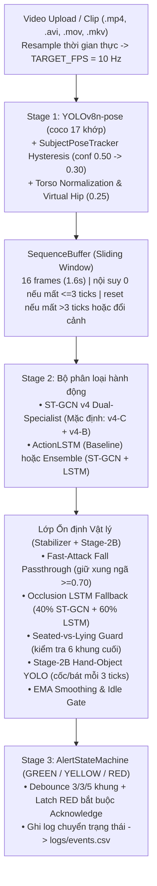

# Tài Liệu Tổng Hợp & Hướng Dẫn Báo Cáo Dự Án — ActionGuard AI

> Tài liệu này được biên soạn đầy đủ từ mã nguồn và kết quả thực nghiệm thực tế để các thành viên trong nhóm **nắm nhanh toàn bộ kiến trúc hệ thống**, **cài đặt & chạy thử ngay**, và **trích xuất trực tiếp nội dung/bảng số liệu vào báo cáo hoặc slide thuyết trình**.

---

## 1. Tổng quan đề tài & Bài toán

### 1.1 Mục tiêu
**ActionGuard AI** là hệ thống nhận diện hành động người và cảnh báo té ngã thời gian thực từ luồng video camera/file tải lên, hướng tới kịch bản giám sát an toàn (người cao tuổi, người ở một mình, môi trường y tế/gia đình) chạy được hoàn toàn trên **CPU phổ thông** (không yêu cầu GPU rời) thông qua giao diện web **Streamlit**.

### 1.2 Không gian nhãn (8 hành động) & Máy trạng thái cảnh báo 3 mức
Hệ thống phân loại chuỗi cử động khung xương trong cửa sổ `16` khung hình (`1.6 giây` @ `10 FPS`) thành **8 lớp hành động** chuẩn (`src/utils/config.py::CLASS_NAMES`), ánh xạ sang **3 mức cảnh báo**:

| Chỉ số (`idx`) | Nhãn hành động | Ý nghĩa | Mức cảnh báo | Ngưỡng & Cơ chế kích hoạt |
|---:|---|---|---:|---|
| `0` | `Walk` | Đi bộ | `GREEN` | Bình thường (giúp khôi phục cảnh báo sau `5` khung hình liên tiếp) |
| `1` | `Eat` | Ăn uống (đưa tay/thìa/bát lên miệng) | `GREEN` | Bình thường |
| `2` | `Drink` | Uống nước (cầm cốc/chai đưa lên miệng) | `GREEN` | Bình thường |
| `3` | `Fall` | **Té ngã (pha đổ sập người)** | **`RED`** | **3 khung liên tiếp** $P(\text{Fall}) \ge 0.75$ **hoặc** 1 khung $P(\text{Fall}) \ge 0.90$ (*Instant RED*) — **Chốt giữ RED** tới khi người trực nhấn *Acknowledge* |
| `4` | `Lying` | **Nằm yên (trên sàn/giường)** | **`YELLOW`** | **3 khung liên tiếp** $P \ge 0.50$ |
| `5` | `Sit_Down` | Ngồi xuống | `GREEN` | Bình thường |
| `6` | `Stand_Up` | Đứng lên | `GREEN` | Bình thường |
| `7` | `Crouching` | **Ngồi xổm / Cúi thấp rủi ro** | **`YELLOW`** | **3 khung liên tiếp** $P \ge 0.50$ |

> Ngoài 8 nhãn chính, lớp ổn định vật lý runtime còn trả về `Idle` (người đứng/ngồi yên không có hành động rõ rệt → `GREEN`), `No_Person` (không thấy người), và `Low_Pose_Quality` (khung xương quá mờ/thiếu khớp — tuyệt đối không làm mất trạng thái `YELLOW`/`RED` đang giữ).

---

## 2. Kiến trúc hệ thống End-to-End (Two-Stage Pipeline)

Dự án tách riêng **Stage 1 (Trích xuất khung xương từ ảnh RGB bằng YOLO-Pose pretrained)** và **Stage 2 (Phân loại chuỗi hành động trên tọa độ khung xương bằng ST-GCN / LSTM)** thay vì đưa thẳng ảnh RGB vào mạng CNN 3D nặng. Cách thiết kế này giúp mô hình phân loại nhẹ (~281K tham số), tránh học lệch theo màu áo/phông nền và chạy mượt trên CPU.



---

## 3. Dữ liệu & Tiến trình làm sạch (Dataset V1 → V3b → V4)

### 3.1 Chuẩn hóa khung xương (`src/utils/skeleton_utils.py`)
Mỗi khung hình lấy **17 khớp COCO** `(x, y, conf)` (`nose, eyes, ears, shoulders, elbows, wrists, hips, knees, ankles`). Để bất biến theo vị trí đứng và độ phân giải camera, vector tọa độ được chuẩn hóa theo công thức:
1. Loại bỏ các khớp chưa phát hiện có tọa độ `(0, 0)` hoặc `conf <= 0` trước khi tính toán.
2. **Gốc tọa độ:** Trung điểm hai khớp hông `hip_mid = (left_hip + right_hip) / 2`.
3. **Thước đo chuẩn:** Chiều dài thân người `torso_scale = ||shoulder_mid - hip_mid||_2` (kèm đảo dấu trục `y` hướng lên dương để khớp với trực giác không gian vật lý).
4. **Virtual Hip Fallback (Xử lý góc quay bán thân trên):** Khi quay cận bàn ăn (`Eat`/`Drink`) mà bàn che mất hông/chân, hệ thống ước lượng hông ảo phía dưới trung điểm vai theo chiều rộng vai và gắn cờ tin cậy đặc biệt **`conf = 0.25`** (tách biệt với hông thật $\ge 0.30$).

### 3.2 Tiến hóa 3 thế hệ dữ liệu (Đóng góp nghiên cứu quan trọng)
- **Dataset V1 (`393` clips train / `83` val / `83` test):** Bộ nền tảng ban đầu. Nhược điểm: chia ngẫu nhiên theo clip nên cùng một người xuất hiện ở nhiều góc quay có thể rơi vào cả Train và Test ở các clip V2 bổ sung sau đó (`V3.0` rò rỉ dữ liệu ở mức người thực hiện).
- **Dataset V3b (Group-Disjoint Split + Sealed Split):** Audit lại toàn bộ dữ liệu gốc và chia tách **tuyệt đối độc lập theo người thực hiện / phiên quay (`performer / session group`)**, tạo ra 2 tập kiểm chứng chuẩn khoa học:
  - **`ALL_TEST`**: `147` clip (`906` cửa sổ trượt), gồm `83` clip V1 legacy + `64` clip V2 group-heldout.
  - **`SEALED_GROUP_TEST`**: `89` clip (`645` cửa sổ) thuộc 3 nhóm người hoàn toàn tách biệt (`avi:P002`, `avi:P045`, `mp4:S0`), chỉ dùng để đánh giá cuối cùng.
- **Dataset V4 (`5,197` cửa sổ train — Bản chính thức hiện tại, `scripts/build_dataset_v4.py`):**
  - *Vấn đề phát hiện khi test video ngoài đời thực:* Trong dữ liệu `Fall` gốc, một video dài 5 giây gồm 1s đứng/ngồi bình thường + 1.5s ngã + 2.5s nằm bất động trên sàn nhưng **toàn bộ 5 giây đều bị gán nhãn `Fall`**. Điều này làm mô hình học nhầm người đang ngồi/nằm bất động là đang té ngã.
  - *Giải pháp đã thực hiện:* Xây dựng công cụ gán nhãn biên thời gian (`scripts/fall_annotator_app.py`), rà soát xác thực toàn bộ **`189/189` clip `Fall`** (`data/skeleton_dataset/fall_timestamps.csv`: `647` ticks đứng/ngồi trước ngã, `2,823` ticks pha đổ ngã trung bình `1.49s`, `3,562` ticks nằm yên sau ngã).
  - *Kết quả lọc sạch V4:* Loại bỏ `112` cửa sổ trước ngã và `494` cửa sổ nằm yên sau ngã khỏi nhãn `Fall`; thu hoạch `86` cửa sổ nằm yên sạch bổ sung sang `Lying`; lọc bỏ `115` cửa sổ còn đứng thẳng bị gán nhầm trong lớp `Lying`; kết hợp tăng cường dữ liệu mô phỏng thực tế (che khuất thân dưới, nén tỷ lệ góc máy nghiêng, lật gương và nhiễu khớp).

---

## 4. Kiến trúc Mô hình AI & Các kỹ thuật tối ưu thực tế

### 4.1 Baseline: `ActionLSTM` (`models/action_lstm.pth`, `582,664` tham số)
- Mạng **Bidirectional LSTM 2 tầng** (`input_size = 51`, `hidden_size = 128`, `dropout = 0.3`, lớp phân loại tuyến tính `256 → 8`), đầu vào là tensor `(B, 16, 51)` chứa chuỗi 16 khung hình làm phẳng `(x_norm, y_norm, conf)`.
- Ưu điểm: Rất nhanh trên CPU (`~1.4 ms/sequence`), hữu ích làm mô hình dự phòng khi mất khớp thân dưới.
- Nhược điểm: Không khai thác được cấu trúc liên kết giải phẫu giữa các khớp tay–vai–hông–chân nên độ chính xác tổng thể thấp trên góc quay mới (`V2 Group-Heldout` chỉ đạt `20.0%`, `SEALED` đạt `32.58%` Video Acc).

### 4.2 Mô hình Đề xuất: `ST-GCN v4 Dual-Specialist` (`280,999` tham số/mô hình)
Kế thừa từ đồ thị không-thời gian **Spatial-Temporal Graph Convolutional Network** (4 block residual `64 → 64 → 128 → 128`, đồ thị khớp COCO 3 phân vùng + ma trận học thích nghi $A_{\text{adap}}$, chập thời gian đa tỷ lệ $k \in \{3, 5\}$, và gộp kim tự tháp chú ý thời gian):
1. **Nhánh 1 — `ST-GCN v4-C` (`models/action_stgcn.pth`, Lower-Body Kinematics):**
   - Kênh đầu vào `11` chiều (Tọa độ gốc `3` + Vector & độ dài xương `3` + Vận tốc/tốc độ `3` + Độ cao & vận tốc theo trục dọc so với trung điểm mắt cá chân `2`) + nhánh MLP tổng hợp `6` đặc trưng hình học thân dưới (`góc gối trái/phải`, `độ rơi hông-gối`, `gối-cổ chân`, `chiều cao hông-cổ chân`, `độ rộng bước chân`). Mạnh nhất ở **`Walk`, `Eat`, `Fall`, `Stand_Up`**.
2. **Nhánh 2 — `ST-GCN v4-B` (`models/action_stgcn_v4_b.pth`, Wrist-to-Head Features):**
   - Bổ sung khoảng cách & độ cao cổ tay so với mũi/vai và nhánh MLP tóm tắt hành trình tay–mặt. Mạnh nhất ở **`Drink`, `Lying`, `Sit_Down`, `Crouching`**.
3. **Hợp nhất Dual-Specialist lúc suy luận (`src/pipeline/action_classifier.py::predict_probs`):**
   - Pha trộn xác suất softmax theo trọng số chuyên môn từng lớp `_DUAL_SPEC_W_C = [0.50, 0.70, 0.30, 0.60, 0.25, 0.45, 0.60, 0.40]`.
   - Áp dụng chốt an toàn **`max Fall gate`**: $P(\text{Fall}) = \max(P_{\text{fused}}(\text{Fall}), P_{\text{v4-C}}(\text{Fall}), P_{\text{v4-B}}(\text{Fall}))$ rồi chuẩn hóa lại phân phối xác suất, giúp giữ nguyên độ nhạy té ngã cực đại trong khi giảm báo động giả xuống 4 lần.

### 4.3 Bộ 5 kỹ thuật hậu xử lý thông minh cho video thực tế
1. **Stage-1 `0.30` Hysteresis Tracking (`src/pipeline/detector.py::SubjectPoseTracker`):** Người vừa ngã xuống sàn thường bị YOLO đánh giá `conf` thấp (`0.30–0.49`). Khi đã khóa mục tiêu ở ngưỡng `0.50`, tracker cho phép bám tiếp xuống ngưỡng `0.30` theo IoU khung bao trước đó (Path A) hoặc khung nằm ngang đặc (Path B $\ge 0.35$).
2. **Stage-2B Conditional Hand-Object Context (`src/pipeline/object_context.py`):** Khi $P(\text{Fall}) < 0.40$ và mô hình phân vân `Eat` vs `Drink`, hệ thống cắt vùng thân trên/tay chạy `YOLOv8n` (`yolo_obj_pretrained.pt`) mỗi `3 ticks` để kiểm tra có **cốc/chai** (`cup/bottle`) hay **bát/thìa/đồ ăn** (`bowl/fork/spoon`) không — loại bỏ lỗi đưa tay nghe điện thoại hoặc cởi đồ bị nhận nhầm là uống nước.
3. **Late-Window Seated-vs-Lying Physical Guard (`src/pipeline/stabilizer.py`):** Kiểm tra 6 khung cuối của cửa sổ; nếu vai đang ở vị trí cao thẳng (`late_sh_y_mean > 0.68`, độ nghiêng thân thấp), xác suất `Lying` bị triệt tiêu (`×0.05`) để video *ngồi 1s rồi mới nằm/ngã* không báo nhầm `Lying` khi người còn đang ngồi.
4. **Occlusion Fallback (ST-GCN + LSTM):** Khi cổ chân và đầu gối bị che khuất hoàn toàn (`ank_vis < 0.35`, `kn_vis < 0.50`), tự động pha `40% ST-GCN + 60% LSTM`.
5. **Fast-Attack Fall Passthrough:** Khi phát hiện xung ngã đột ngột $P(\text{Fall}) \ge 0.70$, bỏ qua làm mượt EMA để giữ nguyên biên độ cảnh báo `RED` tức thì không bị trễ.

---

## 5. Tổng hợp số liệu thực nghiệm (Dùng trực tiếp cho Báo cáo & Slide)

### 5.1 So sánh tổng thể trên 2 tập kiểm chứng độc lập
| Tập dữ liệu | Chỉ số đánh giá | `LSTM Baseline` | `ST-GCN v3.0` (Cũ) | `ST-GCN v3.1-C` (V3b) | **`ST-GCN v4 Dual-Specialist` (Đề xuất)** | Cải thiện (`v4` vs `v3.1-C`) |
|---|---|---:|---:|---:|---:|---:|
| **`ALL_TEST`** (`147` clip / `906` cửa sổ) | **Video 8-Class Accuracy** | — | `63.27%` | `72.79%` | **`81.63%`** | **`+8.84 pp`** |
| | **Video Macro-F1** | — | `0.6315` | `0.7254` | **`0.8062`** | **`+0.0808`** |
| | **Window 8-Class Accuracy** | `46.03%` | `60.49%` | `61.81%` | **`74.06%`** | **`+12.25 pp`** |
| | **10-FPS RED False Positive Rate** | `14/125` (`11.20%`) | `5/125` (`4.00%`) | `4/125` (`3.20%`) | **`1/125` (`0.80%`)** | **Giảm 4× báo nhầm** |
| **`SEALED_GROUP_TEST`** (`89` clip / `645` cửa sổ, 3 nhóm hoàn toàn mới) | **Video 8-Class Accuracy** | `32.58%` | `67.42%` | `70.79%` | **`77.53%`** | **`+6.74 pp`** |
| | **Video Macro-F1** | `0.3548` | `0.6623` | `0.5994` | **`0.7495`** | **`+0.1501`** |
| | **Window 8-Class Accuracy** | `28.99%` | `56.74%` | `57.21%` | **`70.39%`** | **`+13.18 pp`** |
| | **Rule-1 Fall Clip Recall** (`TP/13`) | `8/13` (`61.54%`) | `9/13` (`69.23%`) | `11/13` (`84.62%`) | **`11/13` (`84.62%`)** | Giữ nguyên |
| | **10-FPS RED FPR** (`FP/76`) | `16/76` (`21.05%`) | `7/76` (`9.21%`) | `9/76` (`11.84%`) | **`0/76` (`0.00%`)** | **0 báo động đỏ nhầm!** |
| | **Video `Lying` F1 / `Fall` F1** | — | — | `0.0000` / `0.5517` | **`0.6667` / `0.6429`** | Giải quyết nhầm `Lying → Fall` |

### 5.2 Tốc độ suy luận (CPU Laptop, không GPU)
- **Stage 2 (`ActionLSTM`):** `~1.4 ms/window`.
- **Stage 2 (`ST-GCN v4 Dual-Specialist`):** `~6–12 ms/window` (nhỏ hơn nhiều mức mục tiêu `< 15 ms`).
- **Stage 1 (`YOLOv8n-pose`, `imgsz=640`):** `~70–110 ms/tick` tùy độ phân giải video (giảm xuống `imgsz=480` với video HD người to rõ đạt `~60–80 ms/tick` ~ `0.9x–1.0x` thời gian thực).

---

## 6. Giải thích cấu trúc mã nguồn & Hướng dẫn chạy

### 6.1 Bản đồ thư mục mã nguồn
- **`src/app.py`**: Điểm vào chính của giao diện Streamlit, điều phối vòng lặp `10 FPS`, quản lý `SequenceBuffer`, hiển thị luồng video nén JPEG nhanh, banner cảnh báo và lịch sử sự kiện.
- **`src/ui/sidebar.py` & `src/ui/overlay.py`**: Giao diện bảng điều khiển bên trái (tải video, chọn mô hình, tùy chỉnh ngưỡng) và vẽ khung xương/nhãn đè lên khung hình.
- **`src/pipeline/`**:
  - `detector.py`: Bọc YOLOv8-pose + `SubjectPoseTracker` (bám mục tiêu có trễ `0.50 → 0.30`).
  - `sequence_buffer.py`: Bộ đệm trượt `16` khung hình, khớp chuẩn tensor cho cả LSTM và ST-GCN.
  - `action_classifier.py`: Định nghĩa kiến trúc `ActionLSTM`, `ActionSTGCN` (tự động nhận diện biến thể `v2.4 / v3.1 / v4-B / v4-C` từ `state_dict`), và hàm hợp nhất `Dual-Specialist` trong `predict_probs()`.
  - `object_context.py`: Stage-2B nhận diện đồ vật quanh tay (`cup`, `bottle`, `bowl`, ...) với bộ nhớ đệm `stride=3`.
  - `stabilizer.py`: Lớp hậu xử lý vật lý (`EMA`, `Idle gate`, `Seated-vs-Lying guard`, `Occlusion fallback`, `Fast-Attack Fall`).
  - `alert_state.py`: Máy trạng thái cảnh báo `GREEN / YELLOW / RED`, cơ chế chốt giữ `RED` và hàm `.acknowledge()`.
- **`src/utils/`**: Hằng số cấu hình (`config.py`), hàm chuẩn hóa tọa độ dùng chung (`skeleton_utils.py`), ghi log CSV (`logger.py`).
- **`models/`**: Chứa 6 file trọng số hoạt động (`yolo_pose_pretrained.pt`, `yolo_obj_pretrained.pt`, `action_stgcn.pth`, `action_stgcn_v4_b.pth`, `action_lstm.pth`, `stgcn_adjacency.npy`) và các Model Card chi tiết.
- **`scripts/`**: Các script công cụ nghiên cứu & kiểm tra (`cli_pipeline_test.py`, `annotate_fall_timestamps.py`, `fall_annotator_app.py`, `build_dataset_v4.py`, `train_stgcn_v4.py`, `run_extraction.py`).
- **`tests/test_pipeline_units.py`**: Bộ **30 bài kiểm thử tự động** (logic state machine, tương đương train/inference, hysteresis `0.30`, Stage-2B, Dual-Specialist fusion).

### 6.2 Các lệnh chạy
```bash
# 1. Tạo môi trường ảo và cài thư viện
python -m venv .venv
.venv\Scripts\Activate.ps1    # (macOS/Linux: source .venv/bin/activate)
pip install -r requirements.txt

# 2. Chạy kiểm thử toàn bộ hệ thống (30/30 tests)
python tests/test_pipeline_units.py

# 3. Khởi chạy giao diện web Demo
streamlit run src/app.py

# 4. (Tùy chọn) Chạy kiểm tra nhanh trên CLI không cần giao diện web
python scripts/cli_pipeline_test.py --video path/to/video.mp4 --model stgcn
```
